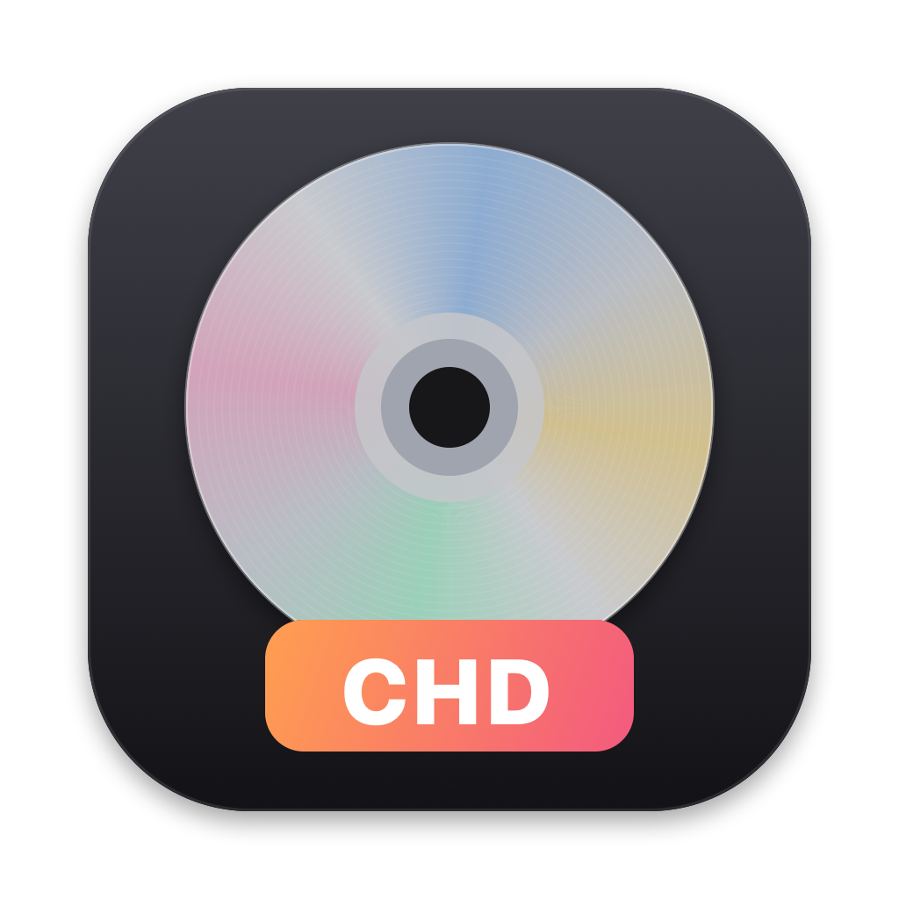
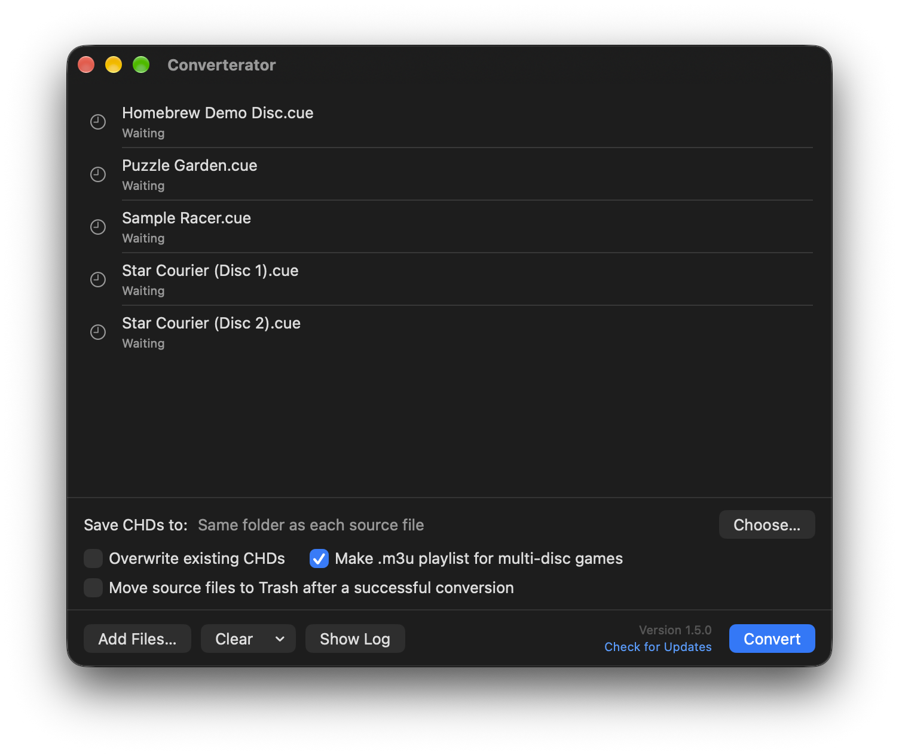

<p align="center">
  
  
</p>

# Converterator

A small native macOS app for turning PlayStation-era disc images into compressed **CHD** files, the format preferred by RetroArch, DuckStation, MAME and most modern emulators.

Drop files or whole folders in, click **Convert**, and you're done.

<p align="center"></p>

## What it converts

| Input | How it's converted |
|---|---|
| `.pbp` (PSP / PS1 Classics EBOOT) | Unpacked to BIN/CUE with [PSXPackager](https://github.com/RupertAvery/PSXPackager), then compressed with `chdman`. Temporary files are deleted afterwards. |
| `.cue` + `.bin` | Compressed straight to CHD with `chdman`. |
| `.gdi` | Compressed straight to CHD with `chdman`. |
| `.iso` | Compressed straight to CHD with `chdman`. |

Dropping a `.bin` on its own uses the `.cue` with the same name next to it.

## Features

- **Batch conversion.** Add any number of files or folders. Folders are searched recursively, and everything is converted one file at a time, with a status and progress bar for each. An overall bar shows progress through the whole batch ("Converting file 3 of 10") with an estimate of the time left, and the Dock icon shows the batch percentage. When the batch ends, a summary of converted, failed and not-started files and the total time taken stays up. Progress is weighted by file size, so big discs count for more than small ones, and CHDs that already exist don't throw off the estimate.
- **Drag and drop.** Drop files on the window or on the Dock icon, or use **Open With → Converterator** in Finder. The app never makes itself the default for these file types.
- **Multi-disc PBPs.** Each disc becomes its own `.chd`. An `.m3u` playlist is written so emulators can swap discs (this can be turned off).
- **Output location.** CHDs are saved next to each source file by default, or all in one folder you choose with **Save CHDs to:**.
- **Skips existing CHDs.** Re-running a folder only converts what's new. Turn on **Overwrite existing CHDs** to replace them instead.
- **Optional cleanup.** Turn on **Move source files to Trash after a successful conversion** to clear out the originals. That's the `.pbp`, `.cue`, `.gdi` or `.iso`, plus any `.bin` or track files a `.cue` or `.gdi` lists. Files go to the Trash, so they can be restored, and only after every CHD for that game was newly written. If a CHD already existed and was skipped, the originals stay. The option turns itself off each time the app starts.
- **Cancel and retry.** **Cancel** stops after cleaning up the current file. **Clear → Retry Failed** re-queues only the failures.
- **Log.** **Show Log** displays the full output from PSXPackager and `chdman` for troubleshooting.
- **Check for updates.** Click **Check for Updates** under the version number, or choose **Converterator → Check for Updates…**. The app asks GitHub for the latest release and, if it's newer, offers to open the download page. It only checks when you ask and sends nothing about you.
- Your output folder and option settings are remembered between launches.

## Download

Get `Converterator.zip` from the [latest release](https://github.com/nickgudauskas/Converterator/releases/latest), unzip it, and move **Converterator.app** to your Applications folder. The app is **universal**: the same download runs natively on both Apple Silicon and Intel Macs.

Release builds from 1.2.1 on are signed with a Developer ID and **notarized by Apple**, so they open with a normal double-click. (Releases 1.0–1.2.0 weren't notarized and needed **System Settings → Privacy & Security → Open Anyway** the first time.)

You still need to install `chdman` (and .NET for PBPs). See the requirements below.

## Requirements

- macOS 14 (Sonoma) or later. Apple Silicon or Intel.
- **chdman**, from Homebrew:
  ```bash
  brew install rom-tools
  ```
- PSXPackager needs the **.NET 10 runtime** to unpack `.pbp` files:
  ```bash
  brew install dotnet
  ```
  This is only needed for `.pbp` input. CUE, GDI and ISO conversion works without it.

If `chdman` or PSXPackager can't be found, the app shows a warning banner at the top of the window.

## Building

You need Xcode or the Xcode Command Line Tools (for `swiftc` and `codesign`).

```bash
git clone https://github.com/nickgudauskas/Converterator.git
cd Converterator
./build.sh
```

The first build downloads PSXPackager v1.8.0 (the Apple Silicon and Intel builds) from its GitHub releases into `vendor/`. The script compiles the app for both architectures, merges them with `lipo` into one universal app, and bundles both PSXPackager builds. The app uses the one that matches the Mac it's running on. (PSXPackager is a .NET single-file app and can't be merged with `lipo`.) The result is `Converterator.app` in the same folder. Move it to `/Applications` to install it. You can build on either kind of Mac.

`./build.sh` signs the app ad-hoc, which is fine on your own Mac. A copy moved to another Mac would be blocked by Gatekeeper until allowed with **System Settings → Privacy & Security → Open Anyway**.

### Signing and notarizing a release

You need an Apple Developer account with a **Developer ID Application** certificate in your Keychain. Save your notarization login once (it asks for an [app-specific password](https://account.apple.com)):

```bash
xcrun notarytool store-credentials converterator-notary --apple-id YOUR_APPLE_ID --team-id YOUR_TEAM_ID
```

Then run:

```bash
./notarize.sh
```

The script:
1. builds and signs every executable with your Developer ID, hardened runtime, and a secure timestamp. PSXPackager also gets the .NET permissions listed in `psxpackager.entitlements`.
2. submits the app to Apple.
3. staples Apple's ticket to the app.
4. writes `dist/Converterator.zip`, ready to upload.

To use a profile with a different name, set `NOTARY_PROFILE`.

### Changing the icon

The icon is drawn in code by `make_icon.swift`. It writes `AppIcon.icon`, an [Icon Composer](https://developer.apple.com/icon-composer/) icon with a purple background in light mode, a graphite one in dark mode, and the disc artwork as a layer. On macOS 26 and later, the system uses the matching version for **System Settings → Appearance → Icon & widget style** (Default, Dark, Clear or Tinted). Earlier versions of macOS show the light icon. `build.sh` compiles it with `actool`.

Edit `make_icon.swift`, then regenerate and rebuild:

```bash
swift make_icon.swift
./build.sh
```

## Project layout

| File | Purpose |
|---|---|
| `main.swift` | The whole app: SwiftUI interface, the conversion queue, and running PSXPackager and `chdman`. |
| `build.sh` | Downloads PSXPackager if needed, compiles, and assembles and signs `Converterator.app`. |
| `notarize.sh` | Builds with Developer ID signing, notarizes with Apple, staples, and zips into `dist/`. |
| `psxpackager.entitlements` | Hardened-runtime permissions the bundled .NET PSXPackager needs. |
| `make_icon.swift` | Draws the app icon in light and dark versions. |
| `AppIcon.icon` | The generated Icon Composer icon that `build.sh` compiles into the app. |
| `icon-preview.png`, `icon-preview-dark.png` | Full-size previews of the light and dark icons. |

## Credits

- [PSXPackager](https://github.com/RupertAvery/PSXPackager) by RupertAvery, for PBP extraction.
- [chdman](https://docs.mamedev.org/tools/chdman.html) from the MAME project, for CHD compression.

Converterator doesn't modify either tool. It runs them as separate programs. `chdman` isn't included; you install it yourself. The built app includes an unmodified copy of PSXPackager, which `build.sh` downloads.

## License

Converterator is released under the [MIT License](LICENSE). PSXPackager, bundled inside the app, is also MIT-licensed. Its license is included in the app at `Contents/Resources/psxpackager/LICENSE`. chdman is part of MAME and keeps its own license.
